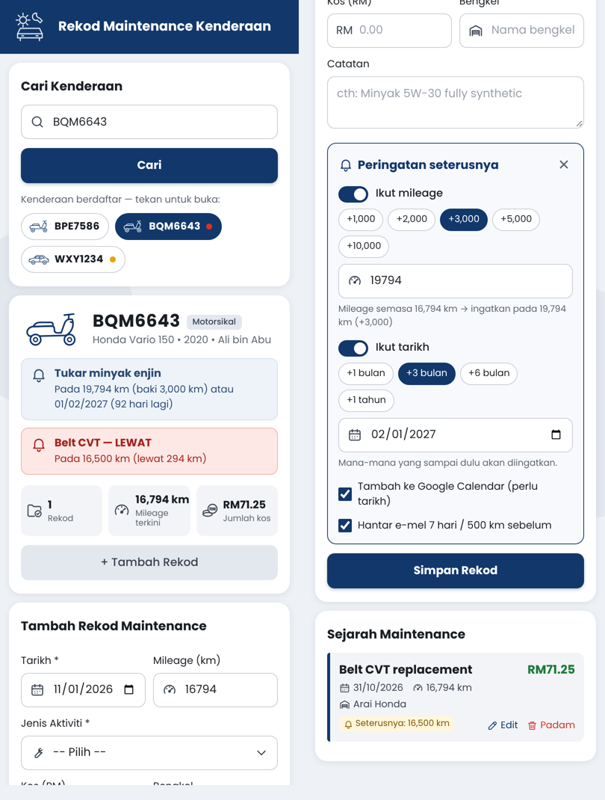

# 🚗 Rekod Maintenance Kenderaan `v2.0.5`

Web app percuma untuk merekod penyelenggaraan kenderaan (motosikal & kereta) ke **Google Sheets**, dibina dengan **Google Apps Script**. Mesra telefon, berbilang pengguna, dengan peringatan servis melalui **Google Calendar** dan **e-mel**.

**🔗 Buka app & panduan:** https://g-03355699-tech.github.io/rekod-maintenance-kenderaan/



## Ciri-ciri

**Kenderaan**
- **Cari ikut nombor plat**, atau tekan butang plat kenderaan yang telah didaftar.
- **Daftar, edit & padam kenderaan** — Motorsikal / Kereta, 15 pilihan ikon, jenama/model, tahun, pemilik. Padam perlu pengesahan dengan menaip nombor plat.
- **Cukai jalan & insurans** — tarikh tamat dengan amaran pada kad kenderaan, e-mel 30 & 7 hari sebelum, dan acara Google Calendar.
- **Kemas kini mileage pantas** — rekod mileage semasa tanpa rekod servis, supaya peringatan ikut mileage kekal tepat.

**Rekod maintenance**
- Tarikh, mileage (auto-isi), jenis aktiviti, kos (gaya ATM: `1453` → 14.53), bengkel (auto-cadang), catatan.
- **Gambar resit** — ambil dari kamera atau galeri; dimampatkan di telefon dan disimpan dalam folder *Resit Maintenance Kenderaan* di Google Drive pengguna.
- Aktiviti "Lain-lain" yang ditaip disimpan ke senarai pilihan.
- **Edit & padam** rekod, dengan pengesahan.
- **Cari & tapis sejarah** ikut kata kunci, aktiviti dan tahun, beserta jumlah kos hasil tapisan.

**Peringatan servis**
- Ikut mileage dan/atau tarikh (mana dulu); status biru / kuning / merah pada kad kenderaan dan butang plat.
- **Templat servis** — pilih aktiviti, selang terus diisi (cth. Tukar minyak enjin motosikal: 3,000 km / 3 bulan). Selang yang anda guna disimpan sebagai templat kenderaan itu.
- Acara **Google Calendar** (notifikasi 7 & 1 hari sebelum) dan **e-mel** ringkasan harian.

**Laporan**
- **Laporan kos** — jumlah, purata sebulan/setahun, kos setiap km, carta kos bulanan/tahunan dan pecahan ikut aktiviti.
- **Eksport PDF** sejarah servis satu kenderaan (berguna semasa menjual kenderaan).

**Pengguna & perkongsian**
- **Berbilang pengguna** — setiap akaun Google mendapat "garaj" (Google Sheet) sendiri dalam Drive mereka.
- **Kongsi garaj dengan ahli keluarga** — masukkan e-mel ahli, berikan kod garaj; ahli boleh tukar antara garaj sendiri dan garaj dikongsi.

## Fail

| Fail | Kegunaan |
|---|---|
| `Code.gs` | Backend Apps Script (Sheet, Calendar, e-mel, trigger) |
| `Index.html` | Antara muka web app |
| `appsscript.json` | Manifest: zon waktu, kebenaran (OAuth scopes), Drive API (v3), tetapan web app |

## Cara pasang

1. Cipta Google Sheet baru → **Extensions → Apps Script**.
2. **Project Settings ⚙️** → tanda **Show "appsscript.json" manifest file in editor**.
3. Dalam Editor `< >`, ganti isi `appsscript.json`, `Code.gs` dan tambah fail HTML bernama `Index` dengan isi dari repo ini. Simpan.
4. Pilih fungsi **`setup`** → **Run** → luluskan kebenaran.
   (Sheet ini akan menjadi Sheet anda sendiri dalam web app dan trigger e-mel harian dipasang.)
5. **Deploy → New deployment → Web app**
   - *Execute as*: **User accessing the web app**
   - *Who has access*: **Anyone with Google account**
6. Kongsi URL `/exec` yang diberi.

Setiap kali kod dikemas kini: **Deploy → Manage deployments → ✏️ Edit → Version: New version → Deploy** (URL kekal sama).

### Untuk pengguna baru

Kali pertama membuka app, pengguna perlu log masuk akaun Google dan meluluskan kebenaran. Google akan memaparkan amaran **"Google hasn't verified this app"** — tekan **Advanced → Go to … (unsafe)** untuk teruskan. Sheet peribadi dicipta automatik dalam Drive pengguna.

Kebenaran boleh ditarik balik bila-bila masa di <https://myaccount.google.com/permissions>.

## Struktur data

**Tab `Kenderaan`:** `No_Plat`, `Jenama_Model`, `Tahun`, `Pemilik`, `Tarikh_Daftar`, `Jenis`, `Ikon`, `Tamat_Cukai`, `Tamat_Insurans`, `Notis_Cukai`, `Notis_Insurans`, `Cal_Cukai`, `Cal_Insurans`

**Tab `Rekod`:** `ID`, `No_Plat`, `Tarikh`, `Jenis_Aktiviti`, `Mileage`, `Kos`, `Bengkel`, `Catatan`, `Masa_Rekod`, `Ingat_Mileage`, `Ingat_Tarikh`, `Ingat_Emel`, `Calendar_ID`, `Emel_Dihantar`, `Resit_ID`, `Resit_URL`

**Tab `Mileage`:** `ID`, `No_Plat`, `Tarikh`, `Mileage`, `Masa_Rekod`

**Tab `Templat`:** `No_Plat`, `Aktiviti`, `Selang_KM`, `Selang_Bulan`

Peringatan yang **aktif** ialah rekod terbaru bagi kenderaan + jenis aktiviti yang sama. Bila rekod baru dengan aktiviti sama ditambah, peringatan lama dianggap selesai (acara Calendar lama dipadam).

## Tetapan (dalam `Code.gs`)

```js
const HAMPIR_KM = 500;        // kuning bila baki <= 500 km
const HAMPIR_HARI = 14;       // kuning bila baki <= 14 hari
const EMEL_HARI_SEBELUM = 7;  // e-mel 7 hari sebelum tarikh peringatan
const DOKUMEN_HARI = [30, 7]; // cukai jalan / insurans: notis 30 & 7 hari sebelum tamat
const JAM_SEMAKAN = 8;        // semakan e-mel harian sekitar 8 pagi
```

## Had

- App yang belum disahkan Google (*unverified*) dengan kebenaran sensitif (Calendar, e-mel) dihadkan kepada sekitar 100 pengguna baru. Untuk lebih, mohon *OAuth verification* di Google Cloud Console.
- Garaj dikongsi: acara Google Calendar dicipta dalam kalendar orang yang menyimpan rekod, dan e-mel harian dihantar kepada pemilik garaj sahaja.
- Resit disimpan dalam Drive orang yang memuat naik, dan dikongsi (lihat sahaja) dengan ahli garaj.
- Kuota Apps Script (e-mel harian, masa larian) dikira bagi setiap pengguna.

## Lesen

[MIT](LICENSE) — bebas digunakan, diubah suai dan diedarkan, dengan syarat notis hak cipta dikekalkan.

---

Dibangunkan oleh **Ibrahim bin Kadri (9M2IBR)**.
